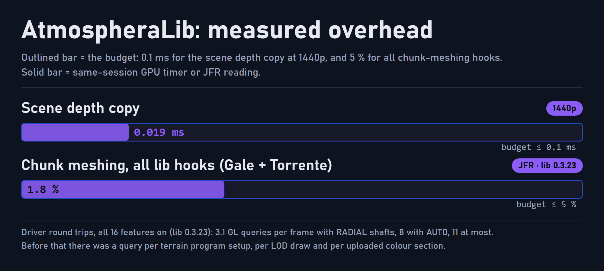

<p align="center">
  
</p>

# AtmospheraLib

AtmospheraLib is the shared rendering library of the [Atmosphera](https://github.com/SolarBiscuit/Atmosphera) suite for Minecraft 1.20.1 on Forge. It patches the terrain shaders of a Sodium-port renderer (Embeddium or Xenon) once, and gives [Lumis](https://github.com/SolarBiscuit/Lumis), [Torrente](https://github.com/SolarBiscuit/Torrente) and [Gale](https://github.com/SolarBiscuit/Gale) a common set of spare vertex bits, frame uniforms, scene copies, shared world data and a wind and clock service. The three feature mods stay thin because the library owns everything they share.

> **Client-only.** AtmospheraLib is never required on a server: on a dedicated server it logs that it is inactive and does nothing. Without a Sodium-port terrain renderer it also stays inactive.

## Features

This is the feature set AtmospheraLib will have when its [roadmap](#roadmap) is complete. Items marked † are optional infrastructure that is built only if a measurement asks for it.

### Terrain shader patching

- **One owner for the terrain programs.** GLSL snippets from the feature mods are injected into the Embeddium and Xenon chunk programs, the NeoVoxy LOD programs and the translucent pass, for every define combination. A missing anchor disables the one feature that needs it, with a log line, and never crashes.
- **Spare vertex bits.** Five material bits per quad and sixteen light bits per vertex, handed out by name so mods never collide.
- **Mesh hooks.** Mods classify blocks and fluids while chunks are built, from an immutable snapshot, and read neighbours through a fast path inside the section's two-block margin. The library asks each hook once per block.
- **Overlap guard.** An active shaderpack, or another mod that draws terrain, switches the affected features off with a clear reason and no repeated warnings.

### Frame data

- **Frame uniforms.** One uniform block uploaded once per frame (128 slots) with time, wind, sun direction, fog and sky colours, camera and style parameters. Most options are live uniforms and need no recompile.
- **Terrain sampler units.** Mods request texture units by priority, the library assigns them within the driver's limit, and the lowest-priority feature is turned off with a reason when the driver runs out.
- **Post stages.** Passes run after opaque terrain, before translucent terrain or after weather, with the GL state saved and restored for them.
- **Scene copies.** Depth and colour copies of the main target, kept in the right format and counted in texture memory.
- **Temporal infrastructure.** The previous view-projection, a reprojection helper, and history targets that reset on resize, dimension change, teleport and large rotation.

### Shared world data

- **Column field.** One texture of per-column data: the top caster, the top water surface, the top rain blocker and flags. It feeds sun shadows, exact caustic depth, wet sheen and plant shelter, and is built with a small scan budget and checked against the slow path.
- **Sun source.** The direction of the sun a skybox actually draws (Nuit Forged), falling back to the vanilla sun.
- **Wind and clock.** A shared clock with a published hour-cycle rule, so no animation jumps at a wrap, and a wind service with a CPU API for particles and other mods.

### Diagnostics and tooling

- **`/atmosphera status`** lists features and why any is off, vertex bit use, assigned texture units, GL queries per frame, GL object counts and the wind.
- **GPU timers** write a CSV of per-pass times. A dev clock override freezes the shader and world clocks so test screenshots are frame-exact.
- **Cheap by design.** Post passes allocate nothing per frame, GL state is read from vanilla's cache after a self-check, and uploads set up their unpack state once per batch.
- **Persistent-mapped upload ring†** for 3D texture uploads, and **Fabulous graphics compositing†**, if the timers ever show the need.

## Performance

AtmospheraLib is built to a budget: **at most 0.1 ms of GPU time for the scene depth copy at 1440p**, nothing allocated per frame in steady state, and at most 5 % of chunk meshing for all hooks together.

<p align="center">
  
</p>

The figures below are the project's own measurements, taken with the in-repo scenes and tools on the RatPack 2.9 test client, an RX 7900 XTX. **Only AMD hardware has been tested.** On NVIDIA, the threaded-optimization driver makes every `glGet` wait for the driver thread, which is why the query count is tracked. The effect there is unverified.

| Metric | Result |
|---|---|
| **Frame rate**, 1440p uncapped, no library / library with three debug features | 801 / 818 fps median (within noise); at 854x480, 941 / 908 fps (+0.04 ms) |
| **GPU**, scene depth copy | 0.019 ms at 1440p, 0.006 ms at 854x480 |
| **Sync**, GL queries per frame, all 16 features on | **3.1 on average with Lumis's RADIAL shafts, 8 with its AUTO march, 11 at most** (lib 0.3.23). Before, there was one or more per terrain program setup, per LOD draw and per uploaded colour section, plus 7 per upload batch and 6 per heightfield upload |
| **CPU**, chunk meshing | all library hooks, with Gale and Torrente: 2.8 % → **1.8 %** of meshing samples (lib 0.3.21 → 0.3.23), against the 5 % budget |
| **Allocation**, steady state, 105 s JFR | the one source found (10.2 MB, a once-a-second config stat) was removed in 0.4.0; post passes and GL state snapshots allocate nothing per frame |
| **VRAM**, column field | 2 MB at 512 x 512 blocks (MEDIUM) |

## Roadmap

| Release | Theme | Content |
|---|---|---|
| 0.2 to 0.3 | Foundation | Shader patching, vertex bits, frame uniforms, depth copies, wind, GPU timers, hygiene and fewer GL queries |
| 0.4.0 | Capacity | 128 uniform slots, more sampler units, the before-translucent stage, wind axes |
| 0.5.0 | Shared world data | Column field, sun source |
| 0.6.x | Temporal | Reprojection and history targets, dev clock override, config folder |
| 0.7.x | Sky | Cloud, sky and Distant Horizons contracts, cloud shadows, the `SKY` stage and sky colour |
| 0.8.x | Reload and sky view | `/atmosphera reload` and the reload key, the sky-view map for water and terrain, lightning flash for other mods, Atmospherics in the overlap list |
| 0.9.x | Common side and options (**current: 0.9.2**) | Server-safe clock, wind and Weather service; settings screen polish (mod icons, one "defer" category, fixed page order); `SkySource.nightLight` |
| Unscheduled | Optional | Upload ring†, Fabulous compositing†, only if measured |

Dates are not promised. Each feature release is a minor version (0.X.0). Version 1.0.0 is only used when the project is declared complete.

## Requirements

- Minecraft **1.20.1** with Forge **47.x**
- Java **17** or newer
- An Embeddium-based terrain renderer, for the library to do anything (developed and tested with Xenon 0.3.31)
- Optional: NeoVoxy or Voxy for LODs, Nuit Forged for skybox suns

## Installation

1. Place `atmospheralib-<version>-mc1.20.1-forge.jar` in `mods`, next to an Embeddium-based terrain renderer.
2. Install the mods that use it: Lumis, Torrente and Gale.
3. Options are in the Atmosphera tab of Video Settings, and in `config/Atmosphera/` (before AtmospheraLib 0.6.7: `config/SolConfig/atmosphera/`, moved across automatically).

## Building

```bash
./gradlew :AtmospheraLib:build
```

AtmospheraLib builds from the Atmosphera Gradle multi-project: the four repositories checked out side by side under one root that holds `settings.gradle`, `gradle.properties` and the wrapper. It needs a JDK 17 and writes `AtmospheraLib/build/libs/atmospheralib-<version>-mc1.20.1-forge.jar`.

## Licence and attribution

- AtmospheraLib is licensed under the **GNU General Public License v3.0 only** ([`LICENSE`](LICENSE)). Copyright (C) 2026 SolarBiscuit.
- Additional terms under GPL-3.0 section 7 are in [`NOTICE`](NOTICE). Every copy or substantial portion that you distribute, original or modified, must keep that notice and credit "SolarBiscuit" with a link to <https://github.com/SolarBiscuit/AtmospheraLib>. A modified version must be clearly marked as modified, and must not be presented as the original work or under its name and author without that marking.
- **Compile-only dependency.** [`libs/xenon-0.3.31+mc1.20.1.jar`](libs) is a third-party jar kept in this repository so the library can be compiled against Xenon's classes. It is not part of this project's licence: Xenon is licensed under **LGPL-3.0-only** (as its own `mods.toml` states) by its authors, and it is not bundled into the AtmospheraLib jar.
- The AtmospheraLib jar bundles no third-party libraries. It is built against Minecraft, Forge and Xenon, which are not redistributed with it.
- AtmospheraLib is an independent project. It is not affiliated with, endorsed by, or supported by Mojang Studios, Microsoft, Minecraft Forge, or the authors of Embeddium, Xenon, Oculus or any other mod it works with.

## Reporting issues

Issues belong in the [AtmospheraLib issue tracker](https://github.com/SolarBiscuit/AtmospheraLib/issues). Please include the AtmospheraLib version, your renderer and shaderpack (if any), your GPU and driver, `latest.log` and the output of `/atmosphera status`.
